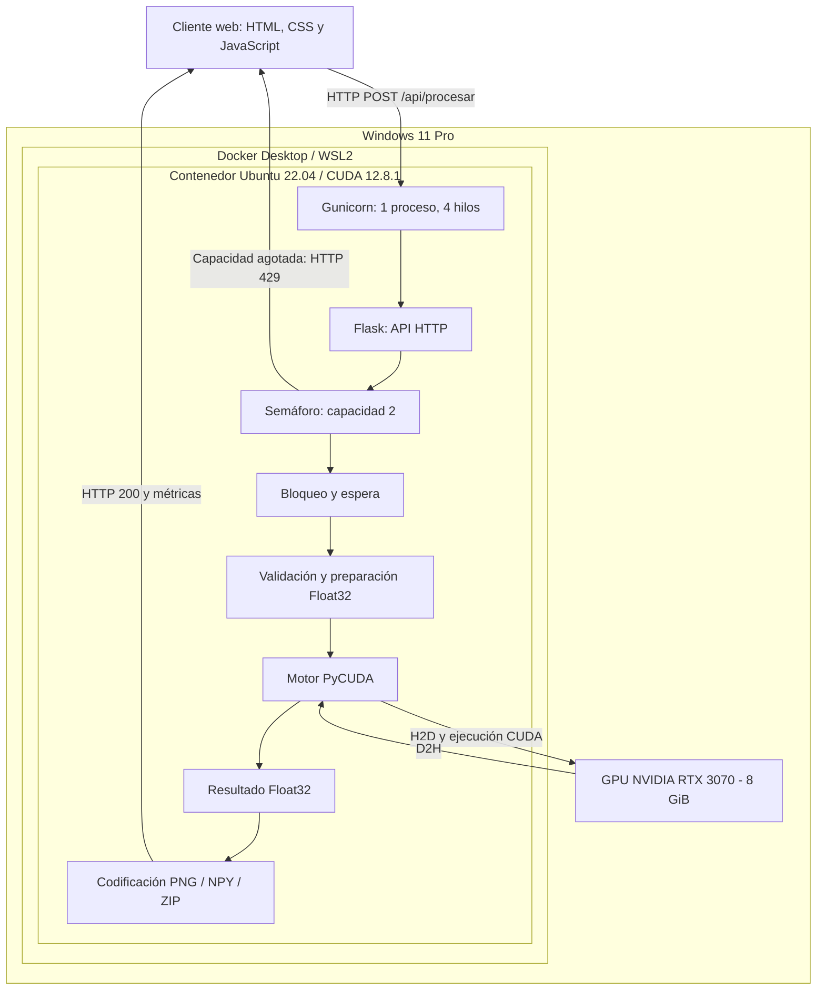
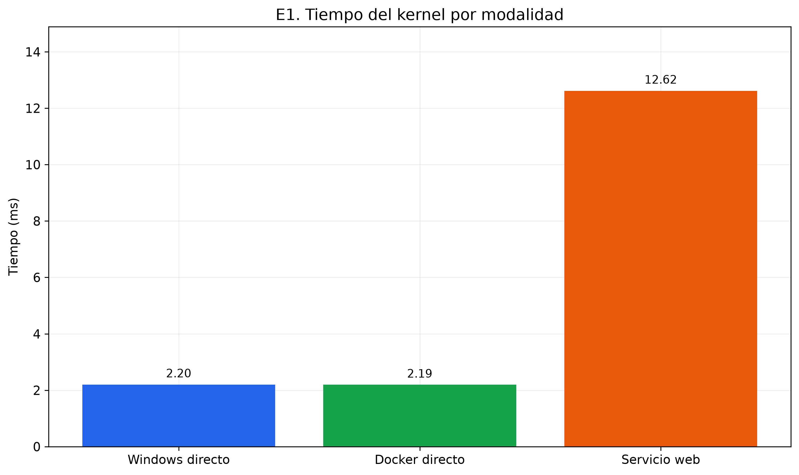
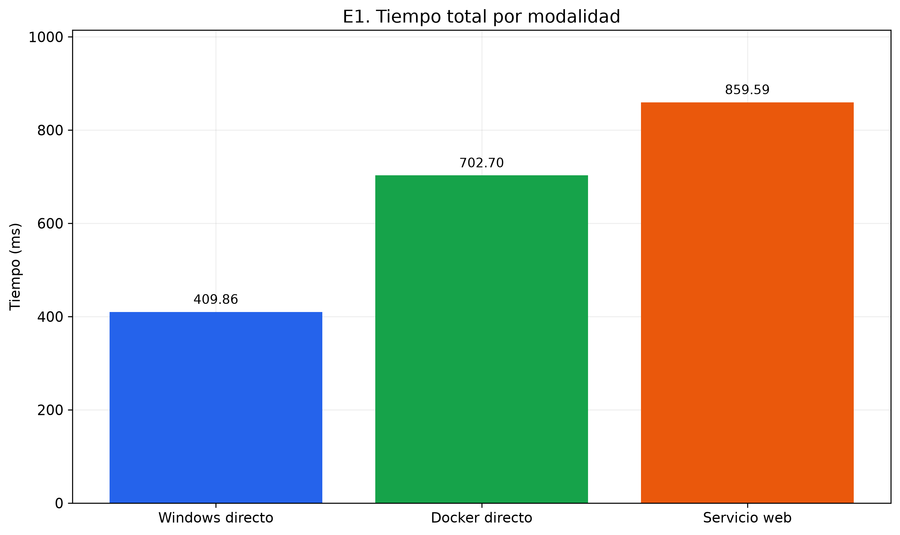
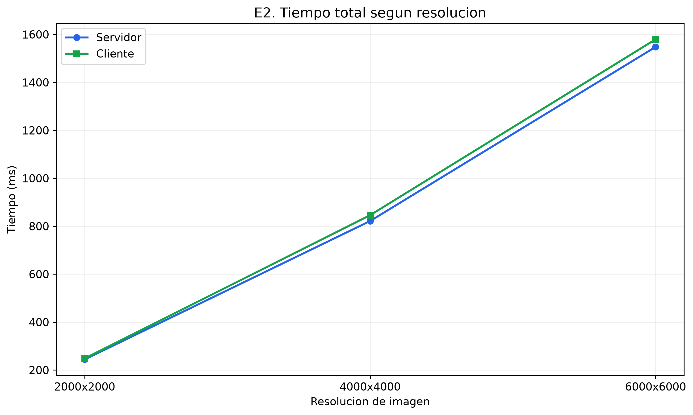
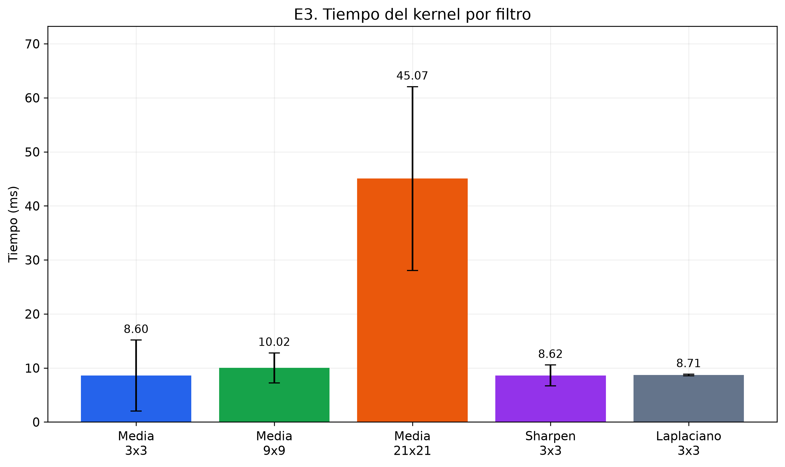
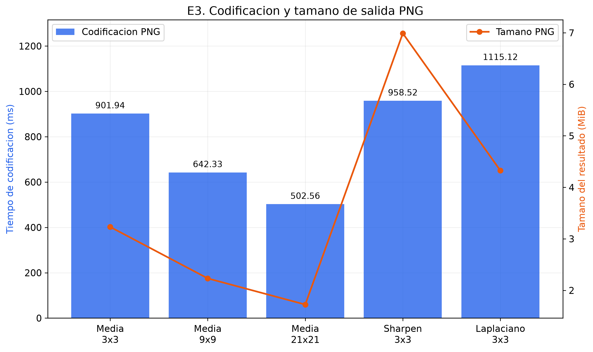
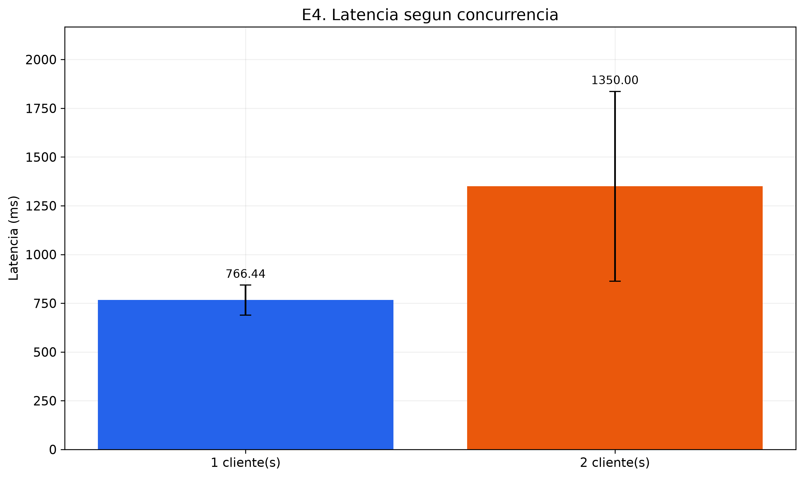
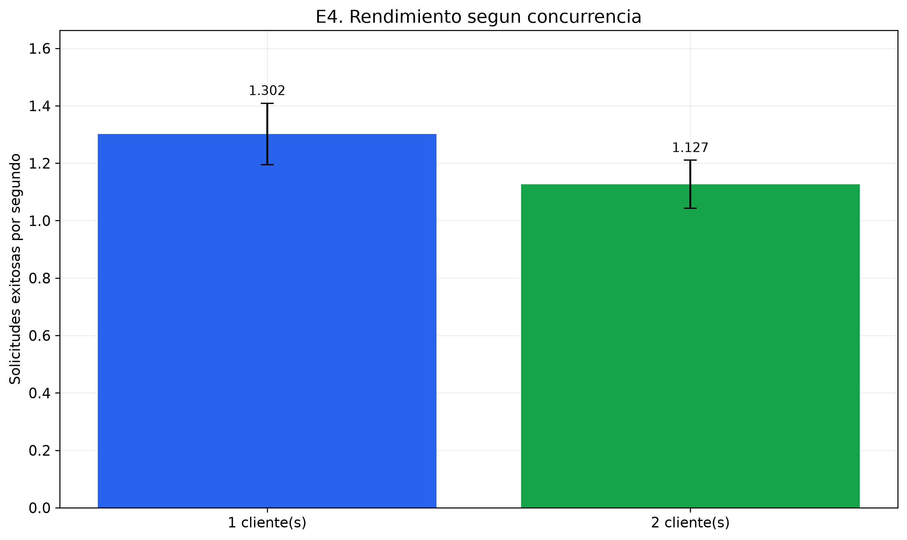
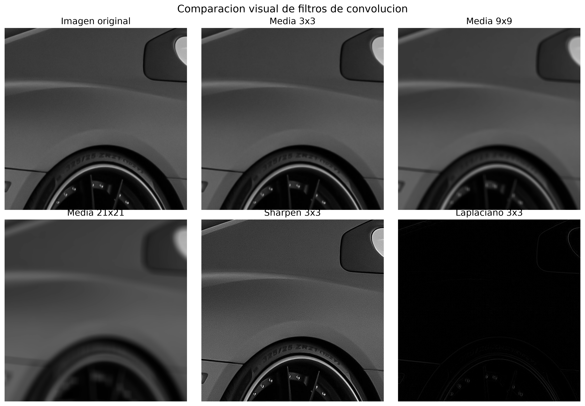

# Desarrollo y despliegue de un servicio web de convolución de imágenes con Docker y PyCUDA

**UNIVERSIDAD POLITÉCNICA SALESIANA (UPS)**

- **Asignatura:** Computación Paralela
- **Práctica de laboratorio:** 03
- **Docente:** Gabriel A. León Paredes
- **Estudiantes:** Noe Ayavaca e Irar Nankamai
- **Fecha:** 24 de noviembre de 2026
- **Repositorio:** [Servicio-Web-Convolucion-Docker-PyCUDA](https://github.com/irarnankamai/Servicio-Web-Convolucion-Docker-PyCUDA)

## 1. Descripción y objetivos

El proyecto implementa un servicio web de convolución de imágenes de alta resolución mediante procesamiento paralelo en una GPU NVIDIA. Integra Python, PyCUDA, Flask, Gunicorn y Docker, reutilizando el kernel de la Práctica 02.

La aplicación permite cargar imágenes, seleccionar filtros y máscaras, procesar imágenes en GPU, visualizar los resultados, descargar archivos PNG y consultar métricas de rendimiento. La API también permite obtener resultados NPY y ZIP.

**Objetivo general:** desarrollar y desplegar un servicio web reproducible de convolución de imágenes acelerado mediante GPU.

**Objetivos específicos:**

- Reutilizar el kernel CUDA y preservar la equivalencia numérica con la implementación anterior.
- Integrar el procesamiento GPU con una API HTTP y una interfaz web.
- Construir y ejecutar un contenedor Docker con acceso a la GPU NVIDIA.
- Validar los resultados numéricos, el manejo de errores y el aislamiento de solicitudes.
- Evaluar el rendimiento según modalidad de ejecución, resolución, filtro y concurrencia.

## 2. Continuidad de la Práctica 02

Repositorio original: [Convolución de imágenes de alta resolución mediante PyCUDA](https://github.com/irarnankamai/Convoluci-n-de-im-genes-de-alta-resoluci-n-mediante-PyCUDA.)

Commit de referencia: `6bcedf33b41254a4dcf8f22fba123caa06782d13`.

Se conservaron los coeficientes de las máscaras, la precisión Float32, la extensión de ceros en los bordes y la asignación de un píxel de salida por hilo. La distribución CUDA utiliza bloques en la dimensión X y filas en la dimensión Y. Se mantiene la opción de compilación `--fmad=false`.

Las modificaciones principales corresponden a la administración explícita del contexto CUDA, la gestión de memoria y eventos, la integración HTTP, la validación de entradas y el control de concurrencia. Se corrigió una advertencia relacionada con la liberación de eventos CUDA fuera del contexto del hilo correspondiente; posteriormente se verificó nuevamente el funcionamiento.

Para recuperar la versión original desde la raíz del proyecto:

```powershell
git clone "https://github.com/irarnankamai/Convoluci-n-de-im-genes-de-alta-resoluci-n-mediante-PyCUDA." referencia_p2/original
git -C referencia_p2/original checkout --detach 6bcedf33b41254a4dcf8f22fba123caa06782d13
```

Consultar las instrucciones y dependencias del README de esa revisión para ejecutar la práctica anterior en un entorno compatible. El punto final pertenece al nombre del repositorio original.

## 3. Tecnologías y arquitectura

Python, PyCUDA, CUDA, NumPy, Pillow, Flask, Gunicorn, Docker Desktop, WSL2, HTML, CSS, JavaScript, Requests, Matplotlib, Git y GitHub.



Gunicorn atiende las solicitudes HTTP y Flask gestiona la API. Un semáforo admite como máximo dos solicitudes de procesamiento; un bloqueo serializa la sección de procesamiento, incluyendo preparación y codificación. Una solicitud puede esperar mientras otra se procesa. Las adicionales reciben HTTP 429 cuando se agota la capacidad.

El motor crea el contexto CUDA y compila el kernel al inicializarse. Para cada procesamiento activa el contexto, reserva memoria, transfiere datos H2D, ejecuta el kernel, sincroniza, recupera los resultados D2H y libera los recursos antes de desactivar el contexto. No existe una sustitución silenciosa por CPU ante errores GPU.

Los resultados se mantienen en memoria y cada solicitud recibe un identificador único. El resultado Float32 se conserva para validación; para PNG se recortan los valores al intervalo 0–255 y se convierten a uint8.

## 4. Estructura del proyecto

```text
Servicio-Web-Convolucion-Docker-PyCUDA/
├── codigo/           # Kernel, máscaras y motor GPU
├── evidencias/       # Registros e identificadores de ejecución
├── experimentos/     # Scripts de medición y gráficas
├── graficas/         # 15 gráficas experimentales
├── imagenes/         # Entradas PGM y hashes SHA-256
├── pruebas/          # Validaciones numéricas y funcionales
├── referencia_p2/    # Referencia de la práctica anterior
├── resultados/       # CSV y resultados procesados
├── static/           # CSS y JavaScript
├── templates/        # Interfaz HTML
├── .dockerignore
├── .gitignore
├── Dockerfile
├── README.md
├── app.py
└── requirements.txt
```

## 5. Entorno experimental

| Componente | Especificación |
|---|---|
| Equipo | Dell OptiPlex 7000 |
| CPU | Intel Core i9-12900K, 16 núcleos, 24 procesadores lógicos |
| RAM | 31.7 GB |
| GPU | NVIDIA GeForce RTX 3070, 8192 MiB VRAM |
| Sistema anfitrión | Windows 11 Pro |
| Driver NVIDIA anfitrión | 610.60 |
| CUDA Toolkit anfitrión | 12.9 (NVCC 12.9.86) |
| CUDA UMD informado por nvidia-smi | 13.3 |
| Docker Desktop / Engine | 4.48.0 / 28.5.1 |
| Backend | WSL2 |
| Imagen base | nvidia/cuda:12.8.1-devel-ubuntu22.04 |
| CUDA Toolkit contenedor | 12.8.1 (NVCC 12.8.93) |
| Driver informado dentro del contenedor | 610.47.03; KMD 610.60 |
| Python Windows / Docker | 3.14.0 / 3.10.12 |
| PyCUDA Windows / Docker | 2026.1 / 2025.1.2 |
| NumPy Windows / Docker | 2.4.4 / 1.26.4 |
| Pillow Windows / Docker | 12.2.0 / 11.1.0 |
| Matplotlib Windows / Docker | 3.11.2 / 3.10.1 |
| Compilador Windows | MSVC, Visual Studio 2022 |
| Flask / Gunicorn | 3.1.0 / 23.0.0 |
| Requests en Docker | 2.32.3 |
| Precisión / hilos por bloque | Float32 / 256 |
| Despliegue / puerto | Local / TCP 8000 |

El despliegue se realizó en una GPU física local. No se evaluó un proveedor de nube ni una red externa. El controlador del anfitrión proporciona acceso a la GPU; la versión CUDA UMD mostrada por `nvidia-smi` no equivale a la versión del Toolkit instalado.

## 6. Requisitos y construcción

Se requiere Git, Docker con soporte GPU, una GPU NVIDIA compatible, controladores adecuados y acceso a Internet para descargar dependencias. En Windows se utiliza Docker Desktop con backend WSL2 y contenedores Linux. Para Linux se requiere configurar el runtime NVIDIA correspondiente.

Los comandos siguientes están escritos para PowerShell. Clonar el repositorio:

```powershell
git clone https://github.com/irarnankamai/Servicio-Web-Convolucion-Docker-PyCUDA.git
cd Servicio-Web-Convolucion-Docker-PyCUDA
```

Para reproducir exactamente la revisión del código definitivo (esta revisión no incluye las evidencias posteriores):

```powershell
git checkout --detach 98ddb4f
$commit = git rev-parse HEAD
docker build --label "org.opencontainers.image.revision=$commit" -t practica3-pycuda:final .
```

Para construir la revisión actual del repositorio, permanecer en `main` y ejecutar los dos últimos comandos. Las dependencias Python del contenedor están fijadas en `requirements.txt`.

Verificar GPU y Toolkit:

```powershell
docker run --rm --gpus all practica3-pycuda:final nvidia-smi
docker run --rm --gpus all practica3-pycuda:final nvcc --version
```

## 7. Ejecución del servicio

Si ya existe un contenedor llamado `practica3-web`, detenerlo y eliminarlo antes de crear otro, conservando previamente los resultados necesarios.

```powershell
docker run -d --name practica3-web --gpus all -p 8000:8000 practica3-pycuda:final
docker ps
docker logs practica3-web
Invoke-RestMethod -Uri "http://localhost:8000/api/salud"
```

Abrir [http://localhost:8000](http://localhost:8000). Seleccionar una imagen, filtro y máscara; presionar el botón de procesamiento y descargar el resultado. Para demostrar ambas vistas previas, utilizar PNG o JPEG compatible con el navegador. Los archivos PGM pueden procesarse aunque su vista previa no sea compatible.

El puerto publicado puede quedar accesible desde la red local según el firewall. Para restringirlo al anfitrión, utilizar `-p 127.0.0.1:8000:8000` en lugar de `-p 8000:8000`. No exponer este prototipo directamente a Internet.

## 8. API HTTP

### Estado del servicio

`GET /api/salud`: devuelve información de estado, GPU, hilos, inicialización y compilación; puede devolver HTTP 503 si el servicio está ocupado o no disponible.

### Procesamiento

`POST /api/procesar`, formato `multipart/form-data`.

| Campo | Valores |
|---|---|
| imagen | Archivo JPG, PNG, PGM o BMP válido |
| filtro | Media, Sharpen, Laplaciano |
| mascara | Media: 3, 9, 21; Sharpen y Laplaciano: 3 |
| salida | png, npy, zip |

```powershell
curl.exe -sS -X POST "http://localhost:8000/api/procesar" -F "imagen=@imagenes/imagen_2000.pgm" -F "filtro=Media" -F "mascara=9" -F "salida=png" -D headers.txt -o resultado.png -w "HTTP: %{http_code}\n"
```

Para obtener valores Float32 sin recorte, cambiar `salida=png` por `salida=npy` y guardar como `resultado.npy`. ZIP contiene PNG y NPY. Comprobar HTTP 200 antes de interpretar el archivo como resultado válido.

| HTTP | Significado |
|---|---|
| 200 | Procesamiento correcto |
| 400 | Archivo, dimensiones o parámetros inválidos |
| 413 | Tamaño excedido |
| 429 | Capacidad agotada |
| 503 | Servicio o GPU no disponible, incluido error de recursos |

Las respuestas exitosas incluyen encabezados como `X-Request-ID`, `X-Filtro`, `X-Mascara`, `X-Gpu`, `X-Ancho`, `X-Alto`, `X-Hilos`, `X-Bloques`, `X-H2d-ms`, `X-Kernel-ms`, `X-D2h-ms`, `X-Gpu-total-ms`, `X-Servidor-ms`, `X-Espera-ms` y `X-Salida-ms`. Los errores se comunican mediante respuestas HTTP con información del problema.

### Límites y memoria

- Archivo: máximo 40 MiB; límite global de solicitud multipart: 41 MiB.
- Dimensiones: máximo 6000 × 6000 y 36 millones de píxeles.
- Capacidad: dos solicitudes admitidas; procesamiento serializado.
- Hilos por bloque: 256 en el servicio.

Una imagen de 6000 × 6000 en Float32 requiere 144 000 000 bytes por matriz. Entrada y salida requieren aproximadamente 274.66 MiB en GPU, más la máscara y otros recursos CUDA. El motor verifica la memoria libre antes de reservar los buffers. Esta estimación no incluye toda la memoria del proceso ni los buffers de codificación en CPU.

## 9. Integridad de los datos

| Archivo | Resolución | Bytes |
|---|---|---:|
| imagen_2000.pgm | 2000 × 2000 | 4000017 |
| imagen_4000.pgm | 4000 × 4000 | 16000017 |
| imagen_6000.pgm | 6000 × 6000 | 36000017 |

Los hashes están en [imagenes/hashes_sha256.csv](imagenes/hashes_sha256.csv).

```powershell
Import-Csv .\imagenes\hashes_sha256.csv | ForEach-Object {
    [PSCustomObject]@{
        Imagen = $_.archivo
        Integridad = ((Get-FileHash ".\imagenes\$($_.archivo)" -Algorithm SHA256).Hash -eq $_.sha256)
    }
}
```

Las tres imágenes coincidieron con los hashes originales tras clonar el repositorio.

## 10. Validación numérica y funcional

| Validación numérica | Casos correctos |
|---|---:|
| Matriz manual 5 × 5 | 1/1 |
| CPU frente a GPU, 5 × 5 | 5/5 |
| CPU frente a GPU, 37 × 53 | 5/5 |
| Directo frente a HTTP, 2000 × 2000 | 5/5 |
| **Total** | **16/16** |

La tolerancia absoluta fue `1e-4`, para admitir pequeñas diferencias de redondeo Float32. El error máximo y medio observado fue 0.0 en todos los casos evaluados antes del recorte y la codificación. Las dimensiones irregulares permiten comprobar la cobertura de hilos y el tratamiento de bordes.

La validación funcional obtuvo 13/13 respuestas esperadas: entradas válidas, archivos inválidos o vacíos, ausencia de imagen, filtro desconocido, máscaras incorrectas, límites de tamaño y dimensiones, recuperación y aislamiento.

Las pruebas adicionales de concurrencia comprobaron dos resultados independientes con error 0.0. En una sobrecarga de cuatro solicitudes se observaron dos HTTP 200 y dos HTTP 429; una solicitud posterior obtuvo HTTP 200.

```powershell
docker exec practica3-web python3 -m pruebas.validar_numerica
docker exec practica3-web python3 -m pruebas.validar_servicio
```

Resultados: [validación numérica](resultados/validacion_numerica.csv), [validación funcional](resultados/validacion_servicio.csv) y [validación concurrente](resultados/validacion_concurrencia.csv).

## 11. Metodología experimental

Se mantuvieron la GPU, las entradas, la precisión y los 256 hilos por bloque. Se realizaron calentamientos y cinco repeticiones por configuración; E4 utilizó cinco rondas por nivel de concurrencia. Se calcularon medianas y desviaciones estándar muestrales.

| Experimento | Configuración | Mediciones |
|---|---|---:|
| E1 | Media 9 × 9, 4000 × 4000; Windows, Docker directo y HTTP | 15 |
| E2 | Media 9 × 9; 2000, 4000 y 6000 píxeles por lado | 15 |
| E3 | Cinco combinaciones de filtro y máscara, 4000 × 4000 | 25 |
| E4 | Media 9 × 9, 4000 × 4000; uno y dos clientes | 15 |
| **Total** | | **70** |

Los tiempos se expresan en milisegundos, salvo throughput (solicitudes/s). El kernel se mide mediante eventos CUDA sincronizados. Los demás tiempos utilizan un reloj monotónico de alta resolución. Las transferencias síncronas utilizan buffers NumPy ordinarios, sin asignación explícita de memoria pinned.

| Métrica | Alcance |
|---|---|
| Preparación | Lectura, decodificación y conversión Float32 según modalidad |
| Reserva | Asignación de buffers GPU |
| H2D / D2H | Transferencias CPU–GPU y GPU–CPU |
| Kernel | Ejecución CUDA sincronizada |
| Total GPU | Intervalo desde H2D hasta D2H, incluye sincronización |
| Motor | Procesamiento del motor, incluida gestión de recursos |
| Salida | Preparación y codificación del resultado |
| Servidor | Procesamiento HTTP interno, sin espera previa por bloqueo ni envío completo al cliente |
| Cliente | Desde el envío de la solicitud hasta recibir el cuerpo completo |
| Espera | Tiempo de adquisición del bloqueo |
| Total directo | Lectura, motor y codificación PNG, sin HTTP |
| Throughput | Solicitudes exitosas divididas por duración de la ronda |

La inicialización del contexto y compilación se registran por separado. No se suman medianas independientes como si fueran necesariamente la mediana del total. Los clientes automatizados HTTP se ejecutaron dentro del contenedor mediante localhost.

## 12. Resultados experimentales

### E1. Modalidades de ejecución

Medianas en ms, Media 9 × 9, 4000 × 4000.

| Modalidad | H2D | Kernel | D2H | GPU total | Codificación | Total directo / cliente |
|---|---:|---:|---:|---:|---:|---:|
| Windows directo | 11.352 | 2.202 | 11.081 | 24.761 | 353.291 | 409.856 |
| Docker directo | 9.909 | 2.193 | 13.192 | 24.800 | 646.751 | 702.703 |
| Servicio web | 52.063 | 12.616 | 34.441 | 99.572 | 655.078 | 859.593 |

| Modalidad | Desv. kernel (ms) | Desv. total (ms) |
|---|---:|---:|
| Windows directo | 0.012 | 2.914 |
| Docker directo | 0.022 | 6.463 |
| Servicio web | 1.728 | 13.085 |





Los kernels directos presentan una diferencia inferior al 1 %. El tiempo total directo en Docker aumentó aproximadamente 71.45 %, asociado en gran medida a la codificación PNG. Las versiones de las bibliotecas y los tamaños de PNG difieren entre entornos, por lo que no puede atribuirse todo el incremento a Docker. El mayor tiempo del kernel web tampoco puede atribuirse exclusivamente a HTTP.

### E2. Resoluciones

| Resolución | Kernel (ms) | Servidor (ms) | Cliente (ms) |
|---|---:|---:|---:|
| 2000 × 2000 | 2.568 | 244.362 | 248.510 |
| 4000 × 4000 | 13.421 | 821.635 | 846.058 |
| 6000 × 6000 | 17.397 | 1547.750 | 1579.483 |



El incremento de píxeles aumenta el trabajo de convolución, las transferencias y la preparación de salida. Se procesaron correctamente hasta 36 millones de píxeles.

### E3. Filtros y máscaras

| Filtro | Máscara | Kernel (ms) | Servidor (ms) | Cliente (ms) |
|---|---|---:|---:|---:|
| Media | 3 × 3 | 8.601 | 1062.347 | 1088.217 |
| Media | 9 × 9 | 10.021 | 793.590 | 815.390 |
| Media | 21 × 21 | 45.072 | 651.561 | 674.778 |
| Sharpen | 3 × 3 | 8.619 | 1113.503 | 1141.793 |
| Laplaciano | 3 × 3 | 8.705 | 1274.933 | 1304.939 |



| Filtro | Máscara | Codificación (ms) | PNG (MiB) |
|---|---|---:|---:|
| Media | 3 × 3 | 901.943 | 3.232 |
| Media | 9 × 9 | 642.334 | 2.233 |
| Media | 21 × 21 | 502.556 | 1.725 |
| Sharpen | 3 × 3 | 958.522 | 6.989 |
| Laplaciano | 3 × 3 | 1115.118 | 4.325 |



Media 21 × 21 presenta el mayor tiempo de kernel, pero la menor latencia total de E3. El suavizado produjo un PNG más pequeño y una codificación más rápida. Esto demuestra que optimizar solamente el kernel no garantiza minimizar el tiempo total.

### E4. Concurrencia

| Indicador | Un cliente | Dos clientes |
|---|---:|---:|
| Latencia mediana (ms) | 766.444 | 1350.004 |
| Desv. latencia (ms) | 76.882 | 486.643 |
| Espera mediana (ms) | 0.00038 | 396.551 |
| Kernel mediano (ms) | 4.740 | 38.647 |
| Throughput mediano (req/s) | 1.302 | 1.127 |
| Desv. throughput (req/s) | 0.107 | 0.084 |
| Solicitudes correctas | 5/5 | 10/10 |





La latencia aumentó aproximadamente 76.14 % y el throughput disminuyó aproximadamente 13.46 %. El bloqueo explica la espera de solicitudes concurrentes; la causa exacta de la variabilidad adicional del kernel no fue aislada experimentalmente. Los clientes son lógicos y no representan dos equipos físicos independientes.

## 13. Comparación visual



Se utiliza la misma región central de 512 × 512 píxeles. Media suaviza la imagen, Sharpen realza detalles y Laplaciano destaca cambios de intensidad. La visualización PNG no sustituye la validación de los valores Float32.

[Consultar las 15 gráficas](graficas/) · [Consultar todos los resultados CSV](resultados/) · [Consultar evidencias](evidencias/)

## 14. Reproducción de los experimentos

Ejecutar desde la raíz del proyecto, con el contenedor activo. En Windows se requiere Python, PyCUDA, CUDA Toolkit, MSVC compatible y las dependencias del anfitrión indicadas en la sección 5. Utilizar una terminal con el compilador configurado. El registro de dependencias está en [evidencias/dependencias_windows.txt](evidencias/dependencias_windows.txt). No instalar indiscriminadamente las versiones Linux sobre Python 3.14.

```powershell
python -m experimentos.ejecucion_directa --modo windows
docker exec practica3-web python3 -m experimentos.ejecucion_directa --modo docker_directo
docker exec practica3-web python3 -m experimentos.experimentos_web
docker exec practica3-web python3 -m experimentos.concurrencia
docker cp practica3-web:/app/resultados/. ./resultados/
python -m experimentos.generar_graficas
```

La generación de gráficas requiere NumPy, Pillow y Matplotlib en el anfitrión. Conservar una copia de los CSV originales antes de repetir los experimentos, pues los scripts pueden sobrescribir resultados. Los tiempos pueden variar según carga, hardware y versiones de software.

Archivos principales: [Windows](resultados/mediciones_windows.csv), [Docker directo](resultados/mediciones_docker_directo.csv), [HTTP](resultados/mediciones_web.csv), [concurrencia](resultados/concurrencia.csv), [resumen web](resultados/resumen_web.csv), [resumen modalidades](resultados/resumen_modalidades.csv), [resumen concurrencia](resultados/resumen_concurrencia.csv), [codificación](resultados/resumen_codificacion.csv).

## 15. Trazabilidad y reproducibilidad

| Elemento | Identificador |
|---|---|
| Código definitivo | [98ddb4f](https://github.com/irarnankamai/Servicio-Web-Convolucion-Docker-PyCUDA/commit/98ddb4f) |
| Commit de evidencias | [4d83312](https://github.com/irarnankamai/Servicio-Web-Convolucion-Docker-PyCUDA/commit/4d83312) |
| Imagen inicial 1.0 | 013ff74af4ec |
| Imagen experimental 1.1 | 03e169478db4 |
| Imagen definitiva final | fbfd838198bc |
| Contenedor definitivo | 0f907b3874a7 |

ID completo de la imagen definitiva:

```text
sha256:fbfd838198bceaa1199743a05144b6eea00f2e3d57e85c0116b51e104eb890c5
```

Las mediciones dentro de Docker se realizaron con la imagen experimental 1.1; las mediciones Windows se ejecutaron directamente en el anfitrión. La imagen definitiva incorporó los scripts de pruebas y experimentos y fue verificada mediante HTTP 200 y 16/16 validaciones numéricas. Su inicialización CUDA fue 693.922 ms y su compilación 412.876 ms, registradas por separado.

```powershell
$info = docker image inspect practica3-pycuda:final | ConvertFrom-Json
$info.Id
$info.Config.Labels.'org.opencontainers.image.revision'
```

La etiqueta de revisión coincidió con el commit del código en la construcción definitiva. Los commits posteriores de documentación no cambian la revisión histórica evaluada. Una nueva construcción no tiene por qué generar el mismo ID de imagen.

Evidencias: [ID experimental](evidencias/imagen_experimental_id.txt), [ID definitivo](evidencias/imagen_final_id.txt), [commit de construcción](evidencias/commit_imagen_final.txt), [logs finales](evidencias/verificacion_final_logs.txt).

### Reconstrucción desde una copia limpia

Se clonó el repositorio en `PRACTICA3_VERIFICACION`, se comprobó la integridad de las tres entradas y se seleccionó el commit `98ddb4f`.

```powershell
git checkout --detach 98ddb4f
docker build -t practica3-pycuda:verificacion .
```

La construcción finalizó correctamente (13/13 etapas) en 5.6 segundos con capas en caché. Esto confirma la reconstrucción desde una copia limpia en el equipo evaluado, no una instalación sin caché ni una ejecución independiente en otro equipo.

## 16. Resultados generales

- 16/16 validaciones numéricas correctas, repetidas satisfactoriamente en la imagen definitiva.
- 13/13 validaciones funcionales correctas.
- 70/70 mediciones experimentales correctas.
- 15 gráficas generadas.
- Procesamiento de imágenes de hasta 36 millones de píxeles.
- Aislamiento concurrente, rechazo HTTP 429 y recuperación comprobados.
- Repositorio publicado, integridad de entradas verificada y reconstrucción Docker exitosa.

## 17. Limitaciones

El despliegue fue local; no se midió una plataforma de nube ni la latencia de una red externa. Las versiones de dependencias Windows y Docker difieren. La serialización protege el acceso al motor pero aumenta la espera concurrente. Se observó variabilidad del kernel cuya causa no se aisló. La vista previa PGM depende del navegador, aunque el servidor admite el formato. La reconstrucción utilizó caché y no se verificó una instalación completa en otro equipo. El prototipo no incorpora autenticación ni HTTPS y no está destinado a exposición pública directa.

## 18. Conclusiones

La integración de PyCUDA, Flask, Gunicorn y Docker permitió implementar un servicio funcional de convolución acelerada por GPU. Las validaciones confirmaron equivalencia numérica en los casos evaluados. Los experimentos mostraron que las transferencias, la preparación, la codificación PNG y la concurrencia influyen significativamente en la latencia total. La publicación del código, los datos, los scripts y las evidencias facilita la reproducción y revisión académica del proyecto.

## 19. Detener el servicio

Copiar previamente cualquier resultado nuevo que se desee conservar.

```powershell
docker stop practica3-web
docker rm practica3-web
```

## 20. Referencias técnicas

- [NVIDIA CUDA Documentation](https://docs.nvidia.com/cuda/)
- [PyCUDA Documentation](https://documen.tician.de/pycuda/)
- [Docker Documentation](https://docs.docker.com/)
- [NVIDIA Container Toolkit](https://docs.nvidia.com/datacenter/cloud-native/container-toolkit/latest/)
- [Flask Documentation](https://flask.palletsprojects.com/)
- [Gunicorn Documentation](https://docs.gunicorn.org/)
- [NumPy Documentation](https://numpy.org/doc/)
- [Pillow Documentation](https://pillow.readthedocs.io/)
- [Matplotlib Documentation](https://matplotlib.org/stable/)

## 21. Autoría

Proyecto académico desarrollado por **Noe Ayavaca e Irar Nankamai** para la asignatura de Computación Paralela de la Universidad Politécnica Salesiana, bajo la orientación del docente Gabriel A. León Paredes.
